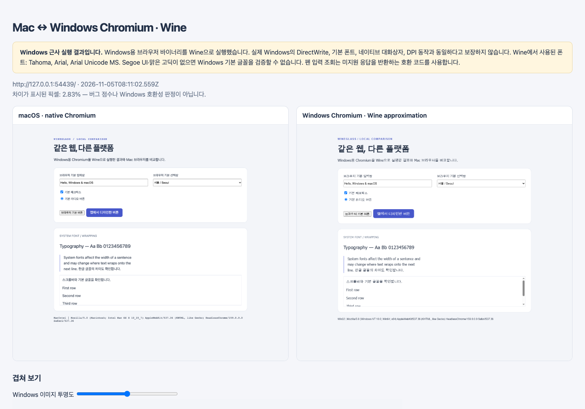

# WineGlass

[English](README.md) | **한국어**

**Mac에서 개발한 웹 UI를 Windows용 브라우저로 열어 봅니다.**

WineGlass은 Mac 안에서 Wine으로 Windows용 Chromium을 실행합니다.
브라우저를 직접 조작하거나, macOS용 Chromium과 비교한 리포트를 저장할 수
있습니다. 두 브라우저는 같은 Chromium 소스 리비전으로 맞춥니다.
원격 Windows 서버나 Windows 가상머신은 필요하지 않습니다.

**Windows 결과는 Wine을 통한 근사 화면입니다.** Windows 11의 글꼴,
텍스트 렌더링, 시스템 동작과 차이가 있습니다. 리포트에 실행 환경과 관찰한
폰트를 기록하며, 결과가 Windows 호환성을 보증하지는 않습니다.



## 설치와 첫 실행

자동 설정은 Apple Silicon Mac을 지원합니다. Node.js 22 이상,
Python 3/pip, [Apple Rosetta](https://support.apple.com/en-us/102527)가 필요합니다.

```sh
git clone https://github.com/IvoryCanvas/WineGlass.git
cd WineGlass
npm ci
npm run setup:wine
npm run demo -- --height 1100 --open
```

첫 설정은 Wine, 같은 버전의 Chromium 두 개와 빌드 도구를 `.runtime/`에
내려받습니다. 수 GB의 디스크 공간이 필요합니다. Windows는 설치하지
않습니다. [첫 실행 안내](docs/quickstart.md)를 참고하세요.

소스는 TypeScript이며 설정·데모 명령이 `dist/`로 자동 빌드합니다.
이미 준비된 환경에서 소스를 수정했다면 `npm run build`로 다시 빌드합니다.

개발 서버를 실행한 뒤 두 브라우저 창을 열어 봅니다.

```sh
node dist/bin/wineglass.js http://localhost:3000 --live
```

터미널에서 Enter를 누르면 두 창이 종료됩니다. 최초 캡처 결과를 저장하며,
이후 조작 내용은 리포트에 자동 반영되지 않습니다. 창을 유지하지 않고
캡처만 하려면 `--live` 대신 `--open`을 사용합니다.

## 결과 확인

| 파일 | 내용 |
| --- | --- |
| `index.html` | 나란히 보기, 투명도 조절 겹쳐 보기, 차이 이미지 |
| `macos.png` | macOS용 Chromium의 보이는 페이지 영역 |
| `wine-windows.png` | Wine에서 실행한 Windows용 Chromium의 페이지 영역 |
| `difference.png` | 두 캡처 사이의 픽셀 차이 |
| `metadata.json` | 브라우저 버전, 플랫폼, 뷰포트, 폰트 표본, 페이지 오류 |

기본 저장 위치는 현재 폴더의 `captures/`이며 `--out`으로 바꿀 수 있습니다.
픽셀 차이는 관찰값입니다. 결함 점수나 Windows 재현 정확도를 뜻하지
않습니다. 동적 콘텐츠와 폰트 대체도 차이에 포함됩니다.

## 확인한 범위

Chromium **159.0.8144.0**의 두 플랫폼 빌드로 데모를 비교했습니다.
뷰포트는 1280 × 1100 CSS 픽셀, DPR은 1입니다. Apple Silicon Mac에서
헤드리스 캡처, 리포트 슬라이더, 두 창 유지와 종료를 확인했습니다.

현재 Wine은 `system-ui`에 Tahoma, 데모 한글에 Arial Unicode MS를
사용했습니다. Windows 11의 Segoe UI·맑은 고딕과 다릅니다. 실제 Windows
참조 캡처와 완전히 새 Mac에서의 설치는 아직 검증하지 않았습니다.
[검증 기록과 한계](docs/verification.md).

## 문서와 기여

| 목적 | 문서 |
| --- | --- |
| 처음 실행하기 | [Quickstart](docs/quickstart.md) |
| 옵션과 기본값 찾기 | [명령어](docs/commands.md) |
| 결과를 프로그램에서 읽기 | [출력 계약](docs/output-format.md), [JSON Schema](schema/metadata.schema.json) |
| 동작 범위와 완료 조건 확인 | [제품 명세](docs/specification.md) |
| 구현 구조 파악 | [아키텍처](docs/architecture.md) |
| 후속 작업 확인 | [로드맵](docs/roadmap.md) |

이 버전은 pre-1.0 프로토타입입니다. 루프백 개발 주소를 입력받으며 기존
브라우저의 로그인 상태를 공유하지 않습니다. 주소창과 OS 대화상자는
캡처하지 않습니다. Wine 브라우저는 `--no-sandbox`와 GPU 가속 비활성화
상태로 실행하므로 신뢰할 수 있는 로컬 앱을 대상으로 사용하세요.
같은 런타임에서는 한 번에 한 명령만 실행합니다.

기여 방법은 [CONTRIBUTING.md](CONTRIBUTING.md), 보안과 데이터 처리 범위는
[SECURITY.md](SECURITY.md), [PRIVACY.md](PRIVACY.md)를 참고하세요.

[English](README.md) | [MIT License](LICENSE)
