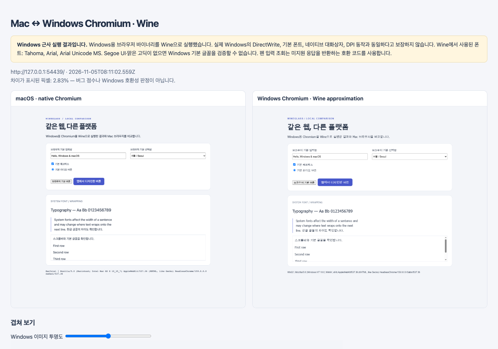

# WineGlass

**English** | [한국어](README.ko.md)

[](LICENSE)

**View your local web UI in a Windows browser, from your Mac.**

WineGlass runs Windows Chromium through Wine on the same Mac as your development
server. Open the browser for direct inspection, or save a comparison with native
macOS Chromium. The two browser builds use the same Chromium source revision.
No remote Windows machine or Windows virtual machine is required.

**The Windows result is a Wine approximation.** Fonts, text rendering and system
behavior differ from Windows 11. The report records the renderer and sampled
fonts; it does not certify Windows compatibility.



## Install And Run

Automatic setup currently supports Apple Silicon Macs with Node.js 22+, Python
3/pip and [Apple Rosetta](https://support.apple.com/en-us/102527).

```sh
git clone https://github.com/IvoryCanvas/WineGlass.git
cd WineGlass
npm ci
npm run setup:wine
npm run demo -- --height 1100 --open
```

Setup downloads Wine, matching Chromium builds and a build toolchain into
`.runtime/`. Allow several GB of disk space. It does not install Windows.
[First-run guide](docs/quickstart.md).

The source is TypeScript. Setup and demo commands build it into `dist/`
automatically. Use `npm run build` to rebuild an existing installation.

With your development server running, inspect both browser windows:

```sh
node dist/bin/wineglass.js http://localhost:3000 --live
```

Press Enter in the terminal to close them. The initial report is saved; later
interactions do not update it automatically. For capture without keeping the
windows open, use `--open` instead of `--live`.

## Read The Result

| File | Contents |
| --- | --- |
| `index.html` | Side-by-side screenshots, opacity overlay and difference image. |
| `macos.png` | Native macOS Chromium viewport. |
| `wine-windows.png` | Windows Chromium viewport rendered through Wine. |
| `difference.png` | Pixels that differ between the captures. |
| `metadata.json` | Browser versions, platforms, viewport, sampled fonts and page errors. |

Results go to `captures/` in the current directory, or to `--out`. A pixel
difference is an observation, not a defect score. Dynamic content and font
substitution also produce differences.

## Verified So Far

The local demo ran in Chromium **159.0.8144.0** on both platforms at a 1280 × 1100
CSS viewport and DPR 1. Headless capture, the report overlay and interactive
window lifetime were exercised on an Apple Silicon Mac.

Wine selected Tahoma for `system-ui` and Arial Unicode MS for the demo's Korean
text. Those differ from Windows 11's Segoe UI and Malgun Gothic defaults.
Real Windows reference captures and installation on a clean second Mac remain
unverified. [Evidence and limits](docs/verification.md).

## Documentation

| Goal | Guide |
| --- | --- |
| Capture a first page | [Quickstart](docs/quickstart.md) |
| Look up flags and defaults | [Commands](docs/commands.md) |
| Consume the output | [Output format](docs/output-format.md), [JSON Schema](schema/metadata.schema.json) |
| Review scope and acceptance criteria | [Specification](docs/specification.md) |
| Change the implementation | [Architecture](docs/architecture.md) |
| Follow pending work | [Roadmap](docs/roadmap.md) |

## Limits And Contributing

This is a pre-1.0 prototype. It accepts loopback development URLs, uses fresh
browser contexts and captures the page viewport. Existing login state, browser
chrome and OS dialogs are outside that capture.

The Wine browser runs with `--no-sandbox` and GPU acceleration disabled. Use
trusted local pages and one command per runtime. The documented pointer-device
shim reports unsupported pen-device lookup. See [Security](SECURITY.md).

Small public reproductions are welcome. Start with [CONTRIBUTING.md](CONTRIBUTING.md).

[한국어](README.ko.md) | [Privacy](PRIVACY.md) | [MIT License](LICENSE)
